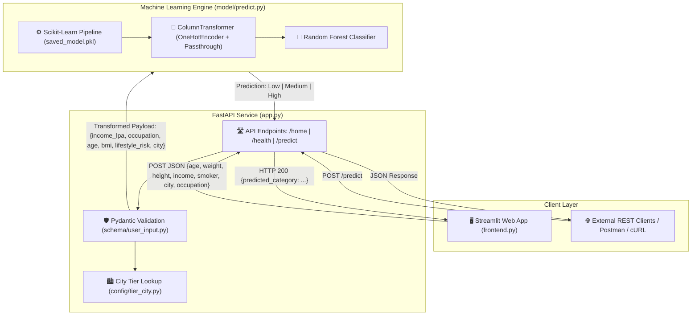

# 🛡️ Insurance Premium Category Predictor & Risk Underwriting System

[](https://www.python.org/)
[](https://fastapi.tiangolo.com/)
[](https://streamlit.io/)
[](https://scikit-learn.org/)
[](https://docs.pydantic.dev/)
[](https://www.docker.com/)
[](LICENSE)

An end-to-end Machine Learning and intelligent risk underwriting platform designed to automate and categorize insurance premium levels (**Low**, **Medium**, **High**) for policy applicants. The system integrates automated actuarial feature engineering, a Scikit-Learn **Random Forest** classification pipeline, a production-grade **FastAPI** REST backend with Pydantic v2 computed validation, an interactive **Streamlit** web dashboard, and containerized **Docker** packaging.

---

## 📌 Table of Contents

- [Overview](#-overview)
- [Key Features](#-key-features)
- [System Architecture](#-system-architecture)
- [Actuarial Feature Engineering](#-actuarial-feature-engineering)
- [Machine Learning Pipeline](#-machine-learning-pipeline)
- [Dataset Summary](#-dataset-summary)
- [API Reference & Documentation](#-api-reference--documentation)
- [Project Directory Structure](#-project-directory-structure)
- [Getting Started](#-getting-started)
  - [Prerequisites](#prerequisites)
  - [Installation & Setup](#installation--setup)
  - [Running the FastAPI Backend](#running-the-fastapi-backend)
  - [Running the Streamlit Frontend](#running-the-streamlit-frontend)
  - [Running via Docker](#running-via-docker)
- [Interactive Testing Guide](#-interactive-testing-guide)
- [Roadmap & Enhancements](#-roadmap--enhancements)
- [License & Contributing](#-license--contributing)

---

## 📖 Overview

Traditional insurance underwriting relies heavily on manual assessment, rigid rules, and slow turnaround times. This project modernizes the underwriting process into an automated, data-driven pipeline:

1. **Intelligent Feature Derivation**: Raw applicant metrics (such as height, weight, age, city, and tobacco usage) are transformed into clinical and demographic risk scores (BMI, age brackets, lifestyle risk indexes, and urban cost-of-living tiers) using **Pydantic v2 computed properties**.
2. **Ensemble Machine Learning Classification**: A serialized **Scikit-Learn Pipeline** combining `ColumnTransformer` (One-Hot Encoding and feature passthrough) with a **Random Forest Classifier** predicts the applicant's risk bracket.
3. **Modular Microservice Architecture**:
   - **Backend API**: High-throughput asynchronous FastAPI server exposing health checks, model metadata, and prediction endpoints with OpenAPI / Swagger documentation.
   - **Frontend UI**: User-friendly Streamlit application offering instant evaluation for insurance agents and policyholders.
   - **Cloud-Ready Deployment**: Containerized with multi-stage Docker support for local and production deployment.

---

## ✨ Key Features

- **Dynamic Actuarial Rules Engine**: Calculates Body Mass Index (BMI), life stage groupings, tobacco-lifestyle risk matrices, and multi-tier city geographic classifications on the fly.
- **Production Pipeline Architecture**: Encapsulates categorical encoding (`OneHotEncoder`) and numeric transformations (`ColumnTransformer`) together with the classification model into a single serialized `saved_model.pkl` pipeline to prevent data leakage.
- **Strict Data Validation & Type Safety**: Powered by Pydantic v2 models with bounded field assertions, computed attributes, and custom error messaging.
- **Interactive Web Interface**: Streamlit dashboard with intuitive input sliders, numerical controls, dropdowns, and clear visual indicators for predicted premium tiers.
- **Self-Documenting REST API**: FastAPI automatically exposes interactive Swagger UI (`/docs`) and ReDoc (`/redoc`) specifications.
- **Containerized & Portable**: Fully dockerized environment with Python 3.11 base image for seamless deployment across AWS, GCP, Azure, or Kubernetes.

---

## 🏗 System Architecture



---

## 🧮 Actuarial Feature Engineering

The system takes 7 base applicant inputs and programmatically transforms them into model-ready features through the Pydantic schema ([`schema/user_input.py`](schema/user_input.py)):

| Base Input | Transformed / Computed Feature | Actuarial Logic / Formula |
| :--- | :--- | :--- |
| **`age`** (int) | **`age_group`** (categorical) | • `< 25`: `"young"`<br>• `25 - 44`: `"adult"`<br>• `45 - 59`: `"middle_age"`<br>• `≥ 60`: `"senior"` |
| **`weight`** (kg) & **`height`** (m) | **`bmi`** (float) | $$\text{BMI} = \frac{\text{weight (kg)}}{\text{height (m)}^2}$$ |
| **`smoker`** (bool) & **`bmi`** | **`lifestyle_risk`** (categorical) | • Smoker **AND** $\text{BMI} > 30$: `"high"`<br>• Smoker **AND** $\text{BMI} > 27$: `"medium"`<br>• Otherwise: `"low"` |
| **`city`** (string) | **`city_tier`** (numeric) | • **Tier 1** (7 Metros: Mumbai, Delhi, Bangalore, Chennai, Kolkata, Hyderabad, Pune)<br>• **Tier 2** (48 Emerging Metros: Jaipur, Chandigarh, Lucknow, Indore, etc.)<br>• **Tier 3** (All other cities and rural regions) |
| **`income_lpa`** | Raw Numeric | Annual income expressed in Lakhs Per Annum (LPA) |
| **`occupation`** | Raw Categorical | Employment category: `retired`, `freelancer`, `student`, `government_job`, `business_owner`, `unemployed`, `private_job` |

---

## 🌲 Machine Learning Pipeline

The core intelligence is driven by a Scikit-Learn `Pipeline` saved in [`model/saved_model.pkl`](model/saved_model.pkl):

```python
Pipeline(steps=[
    ('preprocessor', ColumnTransformer(transformers=[
        ('cat', OneHotEncoder(), ['age', 'lifestyle_risk', 'occupation', 'city']),
        ('num', 'passthrough', ['bmi', 'income_lpa'])
    ])),
    ('classifier', RandomForestClassifier(random_state=42))
])
```

- **Preprocessing Step**:
  - `OneHotEncoder`: Encodes transformed nominal columns (`age_group`, `lifestyle_risk`, `occupation`, and `city_tier`).
  - `passthrough`: Preserves continuous numeric variables (`bmi`, `income_lpa`).
- **Classifier Step**:
  - `RandomForestClassifier`: Ensemble of decision trees trained with bootstrap bagging to minimize overfitting and capture non-linear actuarial boundary conditions.
- **Target Classes**:
  - `Low`: Minimal risk profile; standard/discounted premium.
  - `Medium`: Moderate risk; standard rate with minor loading.
  - `High`: Elevated risk profile (e.g., senior age, high BMI with smoking history, high-tier health costs).

---

## 📊 Dataset Summary

The model is trained on [`insurance.csv`](insurance.csv) representing an actuarial demographic distribution:

| Metric | Description / Value |
| :--- | :--- |
| **Total Records** | 100 historical applicant profiles |
| **Class Balance** | **Low**: 34 records (34%) \| **High**: 33 records (33%) \| **Medium**: 33 records (33%) |
| **Age Range** | 18 – 75 years ($\mu = 47.18 \pm 16.65$) |
| **Weight Range** | 51.1 kg – 119.8 kg ($\mu = 83.89 \pm 21.02$) |
| **Height Range** | 1.50 m – 1.90 m ($\mu = 1.71 \pm 0.11$) |
| **Income Range** | 0.53 LPA – 50.0 LPA ($\mu = 18.40 \pm 16.07$) |
| **Smoking Ratio** | Mixed cohort of smokers and non-smokers |
| **Occupations** | 7 sectors (retired, student, government, private, freelancer, business owner, unemployed) |

---

## 🔌 API Reference & Documentation

FastAPI runs on `http://127.0.0.1:8000` with interactive Swagger docs accessible at `http://127.0.0.1:8000/docs`.

### 1. `GET /home`
Returns a general welcome message and routing guidance.
```json
{
  "message": "Welcome to the Insurance Premium Prediction API. Please use the /predict endpoint to get predictions."
}
```

### 2. `GET /health`
Returns service availability, model version, and model load status.
```json
{
  "status": "ok",
  "version": "1.0.0",
  "model": true
}
```

### 3. `POST /predict`
Evaluates applicant attributes and returns predicted premium category.

#### Request Headers
```http
Content-Type: application/json
```

#### Request Payload
```json
{
  "age": 42,
  "weight": 95.2,
  "height": 1.78,
  "income_lpa": 17.58,
  "smoker": true,
  "city": "Chandigarh",
  "occupation": "freelancer"
}
```

#### Successful Response (`200 OK`)
```json
{
  "predicted_category": "High"
}
```

#### Validation Error (`422 Unprocessable Entity`)
Occurs if numeric constraints fail (e.g., age $< 1$ or $> 120$, weight $\le 0$, invalid occupation):
```json
{
  "detail": [
    {
      "loc": ["body", "age"],
      "msg": "Input should be less than 120",
      "type": "less_than"
    }
  ]
}
```

---

## 📁 Project Directory Structure

```plaintext
Insurance_Premium_claimed/
│
├── config/
│   └── tier_city.py              # Tier-1 and Tier-2 city geographic listings
│
├── model/
│   ├── predict.py                # Model loader & predict_output inference logic
│   └── saved_model.pkl           # Trained Scikit-Learn Pipeline (preprocessor + classifier)
│
├── schema/
│   └── user_input.py             # Pydantic v2 schema with computed field transformations
│
├── app.py                        # FastAPI application with REST endpoints
├── frontend.py                   # Streamlit web application dashboard
├── insurance.csv                 # Source training dataset with applicant records
├── fast_api_ml_model.ipynb       # Jupyter notebook with EDA, preprocessing & model training
├── Dockerfile                    # Container definition for production deployment
├── requirements.txt              # Production Python package dependencies
├── .gitignore                    # Git tracking rules for caches and venvs
└── README.md                     # Comprehensive project documentation
```

---

## 🚀 Getting Started

### Prerequisites

- **Python**: Version `3.11+` recommended
- **Pip**: Latest version
- **Docker** *(Optional)*: For containerized execution

### Installation & Setup

1. **Clone the repository**:
   ```bash
   git clone https://github.com/ghayurabbasbuck/AI_Projects-.git
   cd AI_Projects-/Insurance_Premium_claimed
   ```

2. **Create and activate a virtual environment**:
   ```bash
   # Windows (PowerShell)
   python -m venv venv
   .\venv\Scripts\Activate.ps1

   # Linux / macOS
   python3 -m venv venv
   source venv/bin/activate
   ```

3. **Install dependencies**:
   ```bash
   pip install --upgrade pip
   pip install -r requirements.txt
   ```

---

### Running the FastAPI Backend

Launch the FastAPI application using `uvicorn`:

```bash
uvicorn app:app --reload --host 127.0.0.1 --port 8000
```

- **API Base URL**: `http://127.0.0.1:8000`
- **Interactive Swagger UI**: `http://127.0.0.1:8000/docs`
- **ReDoc Documentation**: `http://127.0.0.1:8000/redoc`

---

### Running the Streamlit Frontend

In a separate terminal (with your virtual environment active):

```bash
streamlit run frontend.py
```

- **Local URL**: `http://localhost:8501`
- Enter applicant details in the browser and click **"Predict Premium Category"** for real-time risk assessment.

---

### Running via Docker

Build and run the entire API inside a lightweight container:

1. **Build the Docker image**:
   ```bash
   docker build -t insurance-premium-predictor:latest .
   ```

2. **Run the Docker container**:
   ```bash
   docker run -d -p 8000:8000 --name insurance-api insurance-premium-predictor:latest
   ```

3. **Verify the container health**:
   ```bash
   curl http://localhost:8000/health
   ```

---

## 🧪 Interactive Testing Guide

### Using `cURL`

```bash
curl -X POST "http://127.0.0.1:8000/predict" \
     -H "Content-Type: application/json" \
     -d '{
       "age": 30,
       "weight": 65.0,
       "height": 1.70,
       "income_lpa": 10.0,
       "smoker": false,
       "city": "Mumbai",
       "occupation": "private_job"
     }'
```

**Expected Response**:
```json
{"predicted_category": "Low"}
```

### Using Python `requests`

```python
import requests

payload = {
    "age": 55,
    "weight": 98.0,
    "height": 1.68,
    "income_lpa": 8.5,
    "smoker": True,
    "city": "Delhi",
    "occupation": "business_owner"
}

response = requests.post("http://127.0.0.1:8000/predict", json=payload)
print("Status Code:", response.status_code)
print("Prediction:", response.json())
```

---

## 🗺️ Roadmap & Enhancements

- [ ] **Model Explainability (XAI)**: Integrate **SHAP** (SHapley Additive exPlanations) or **LIME** into the Streamlit dashboard to explain individual factor weights.
- [ ] **CI/CD Automation**: Add GitHub Actions workflow for automated testing, linting (`flake8`, `black`), and Docker image publishing.
- [ ] **Persistent Audit Logging**: Store underwriting decisions and incoming payloads in a PostgreSQL or MongoDB database for actuarial audit trails.
- [ ] **Continuous Monitoring**: Integrate **Evidently AI** or **Prometheus** to monitor prediction drift and model degradation over time.
- [ ] **Batch Inference API**: Add `/predict/batch` endpoint to allow bulk CSV uploads and batch underwriting scoring.

---

## 📄 License & Contributing

Distributed under the **MIT License**. Contributions, bug reports, and feature requests are welcome. Feel free to open an issue or submit a pull request!
